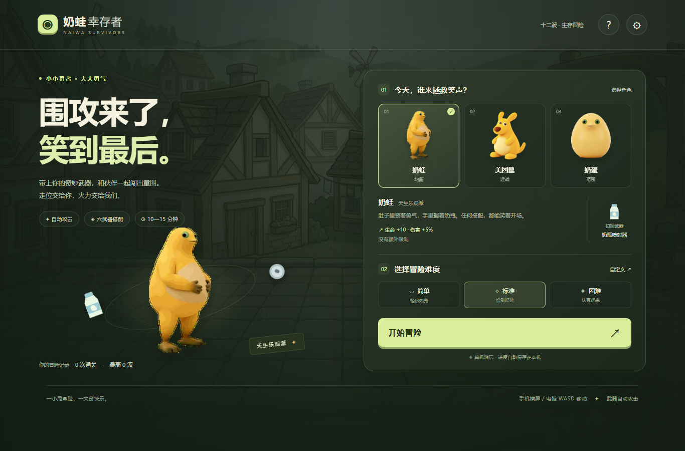
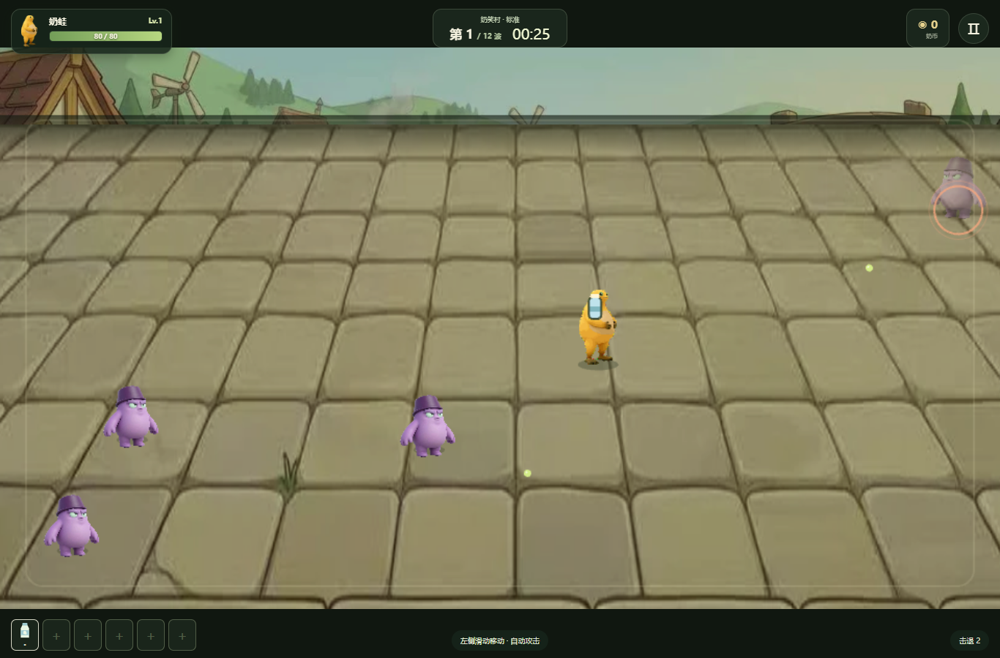
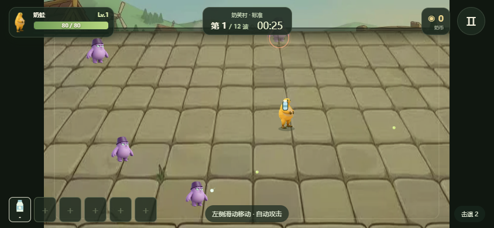

# 奶蛙幸存者

支持手机触屏与电脑键盘的十二波单机生存游戏。选择奶蛙、美团鼠或奶蛋，移动躲避敌人，以自动攻击的武器收集奶币、强化角色并搭配装备。

项目无需账号、数据库或 API 密钥。**当前原创代码未指定开源许可证；部分图片和音乐的再分发授权未确认。公开仓库或分发前需确认授权或替换素材。** 详见 [许可状态](LICENSE.md) 和 [素材来源](docs/ASSETS.md)。

## 真实截图

截图由本项目生产构建在 Edge 实际运行后截取，未修改战斗数值或拼接。手机画面来自触屏模拟，非微信真机。





## 运行

推荐 Node.js 24 LTS（要求 ≥22.12）和随附 npm。解压源码 ZIP 后，进入含 package.json 的 naiwa-survivors-source 文件夹：

```sh
npm ci
npm run dev
```

打开终端显示的本机地址。手机同一局域网测试时可使用 `npm run dev -- --host 0.0.0.0`，访问电脑的局域网地址；仍需满足本机防火墙规则。

```sh
npm test
npm run build
npm run preview
```

`dist/` 为可部署到静态网站托管的完整游戏。不能直接双击 HTML 作为正式运行方式。

首次 npm ci 需要网络下载依赖，不需要设置 .env。Windows 如果 npm.ps1 被策略阻止，可使用 npm.cmd。

## 运行包：无需安装项目依赖

解压 naiwa-survivors-runtime-0.1.0.zip，进入 naiwa-survivors-runtime。安装 Node.js 后执行：

```sh
node scripts/serve.mjs
```

打开 http://127.0.0.1:4173/，保持终端开启，Ctrl+C 停止。运行包已含 dist，无需 npm ci。源码包要先 npm run build，再 npm start。它是静态网页游戏，不是 EXE 或微信小程序。

## 玩法

- 手机在战场空白处按住并滑动；电脑 WASD / 方向键移动，Esc 暂停。
- 12 波，完整倒计时合计 590 秒。升级和购物时间另计；最后一波击败 Boss 可提前获胜。
- 六个武器槽、六类武器、四级品质、20 个被动道具；同类同级可手动合成，满槽购买匹配武器时自动合成。
- 简单、标准、困难及自定义敌人生命/伤害/移速。设置在开局锁定。
- 暗号复活：死亡后点击「暗号复活」，输入 `szx牛逼`；每局一次，满血、3 秒无敌，保留装备与波次进度。
- 存档保存在当前浏览器。清除站点数据会清除存档。存储受限时，保持标签页打开仍保留内存中的进度。
- 音效、背景音乐、震屏、伤害数字均可独立设置。

## 规则、胜负与重开

普通波倒计时结束即过关，无需清空敌人；第六波出现队长，不要求击败队长才能过波。第十二波撑到倒计时结束，或提前击败魔王，即通关。生命归零即失败。590 秒只是战斗倒计时预算，购物和强化另计，目标体验为 10～15 分钟。

掉落的非治疗材料增加奶币和经验，波次结束会结算未拾取的材料。升级强化在波次结束后依次选择，再进入商店购物。进入下一波恢复 20% 最大生命。

| 操作 | 电脑 | 手机 |
| --- | --- | --- |
| 移动 | WASD / 方向键 | 横屏，战场空白处按住拖动形成摇杆，松手停止 |
| 攻击 | 自动，无需攻击键 | 自动，无需攻击按钮 |
| 暂停 / 继续 | Esc 或右上角按钮 | 右上角暂停按钮，再点继续 |
| 购物 / 强化 | 鼠标点击 | 触屏点击、滚动商品 |
| 失败 / 通关后重开 | 点击“重新开局”，沿用本局角色和难度，从第一波开始 | 同左 |
| 游戏中重开 | 暂停 → 保存并返回营地 → 选择 → 开始 → 确认新开一局 | 同左 |

重开会清除本局等级、装备、奶币和复活次数；想保留进度请在营地点“继续冒险”。复活确认后还需要点继续；暗号允许首尾空格，但 szx 必须小写。这是公开的玩法规则，不是登录密码。

完整步骤、注意事项与常见问题见 **[使用教程](docs/USER_GUIDE.md)**。

## 工程

- `src/core.ts`：与画面分离的规则、确定性随机、交易、存档校验及战斗更新。
- `src/data.ts`：角色、武器、道具、敌人与波次配置。
- `src/scene.ts`：Phaser 场景、角色动画、触控与视觉反馈。
- `src/main.ts` / `src/style.css`：营地、商店、难度、设置和复活交互。
- `src/*.test.ts`：规则边界与无作弊整局模拟。
- `scripts/browser-check.mjs`：使用已安装 Edge 的完整交互回归。
- `scripts/stress-check.mjs`：三个短时密集场景的运行与帧时间采样。

```text
src/                         源码与规则测试
public/assets/               随包角色、场景、音乐与敌人
public/licenses/             运行依赖许可证
docs/screenshots/            实际游戏截图
docs/USER_GUIDE.md            独立使用教程
docs/VERIFICATION.md          本次验证及未验证范围
docs/ASSETS.md                素材来源和授权状态
docs/DEPENDENCIES.md          锁定依赖的来源、版本与许可证
docs/licenses/                已安装依赖的许可证和 NOTICE 原文
scripts/serve.mjs             无外部依赖的运行包静态服务
scripts/package-release.ps1   Windows 发布打包入口
scripts/prepare-release.mjs   发布白名单、包内哈希清单
package.json                 项目命令与依赖清单
package-lock.json            锁定依赖树
tsconfig.json / vite.config.ts 类型与构建配置
```

Windows 执行 npm run release 可重新构建并打包，输出至 releases/。脚本使用文件白名单，不复制 .git、站点身份、凭据、缓存、依赖目录或存档。浏览器 QA 按验证文档单独执行。

浏览器脚本要求开发服务已经在 `127.0.0.1:5173` 启动。仅开发环境暴露测试入口；生产构建移除入口。

## 开源与素材

使用 Phaser 3.90、Vite、TypeScript、Vitest、Playwright。运行时仅依赖 Phaser；所有游戏图片和音乐随构建部署，不在运行时访问原参考站点。

参考游戏的奶蛙、奶蛋、敌人、场景及音乐按用户要求复用；美团鼠根据用户提供图片由内置 image_gen 生成。来源与适用范围见 `docs/ASSETS.md` 和 `docs/CHARACTER-PROVENANCE.md`。第三方素材与开源工具的许可证是不同事项，本工程没有把参考素材声明为开源。

## 验证范围

本次结果及复现命令见 [验证记录](docs/VERIFICATION.md)，历史结果见 [首版验收](docs/ACCEPTANCE.md)。微信 iOS/Android 真机、长期发热与真人平衡仍需测试。美团鼠为单图配程序动作，奶蛋是已有姿态切换；不提供跨设备存档、联机或防作弊。Phaser 构建块超过 500 kB，构建会提示体积警告，低端设备加载时间尚需实测。

## 静态部署与微信

把 dist/ 中全部文件部署到 HTTPS 站点的**域名根目录**，再分享链接。资源使用 /assets/... 绝对路径，不能直接放到 GitHub Pages 的 /仓库名/ 子路径；需要统一修改资源路径与 Vite base 并重新验证，或使用域名根目录托管。GitHub 源码仓库本身不会自动运行网页。微信浏览器及国内网络可达性需要真实设备检查。

局域网运行包可用 node scripts/serve.mjs --host 0.0.0.0，手机访问电脑局域网 IP:4173；127.0.0.1 只指向手机自身。静态服务用于本机和可信局域网预览，不替代公网生产托管。

## GitHub 准备

建议仓库名 naiwa-survivors；描述：“支持手机触屏与电脑键盘的十二波自动攻击生存游戏，使用 TypeScript、Phaser 和 Vite。”

见 [上传准备说明](docs/GITHUB.md)。源码包不含 Git 历史，适合在独立目录初始化仓库。本次仅本地整理，上传前需要确认目标仓库完整地址与公开 / 私有状态。
